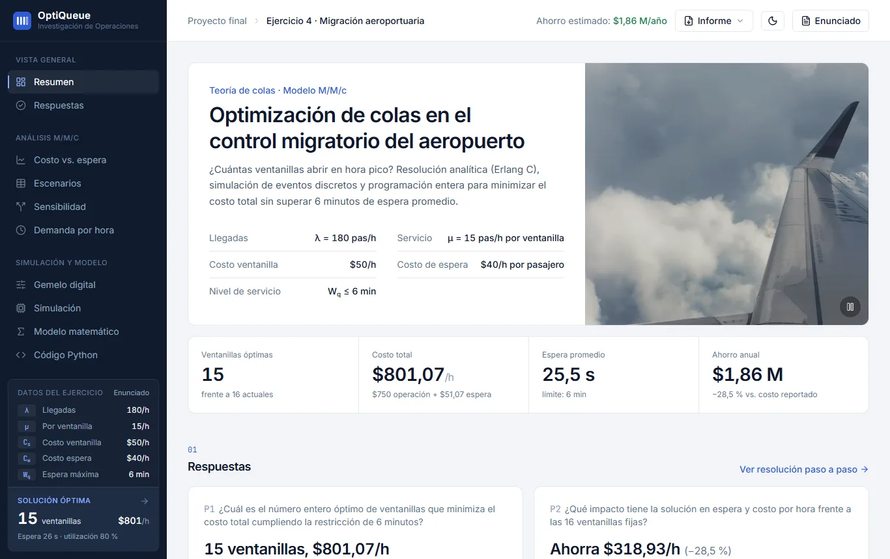
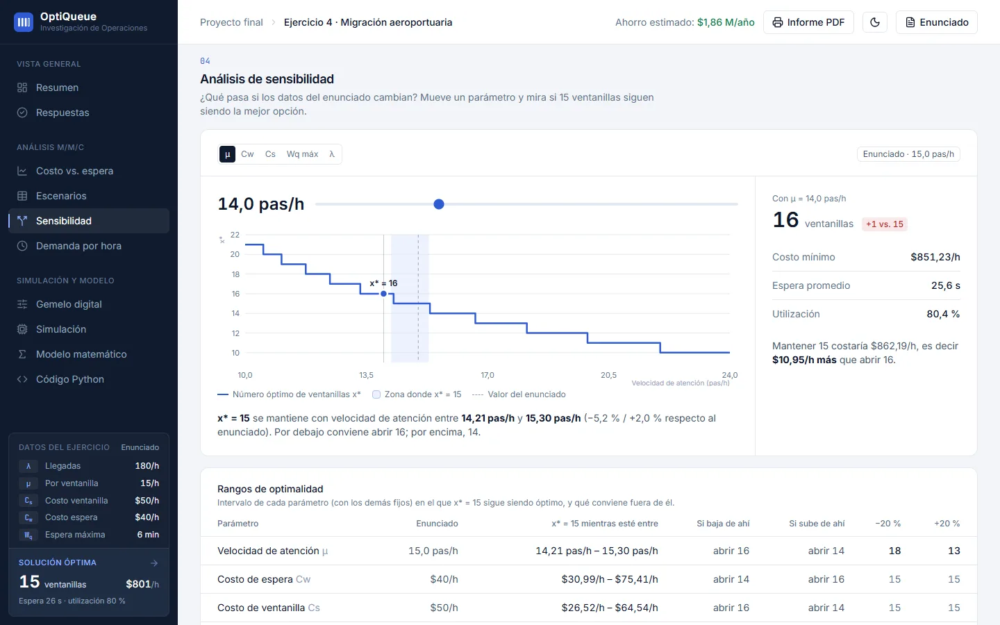
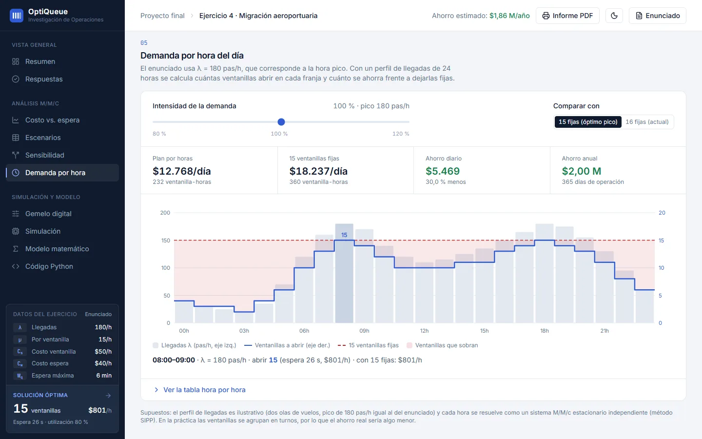
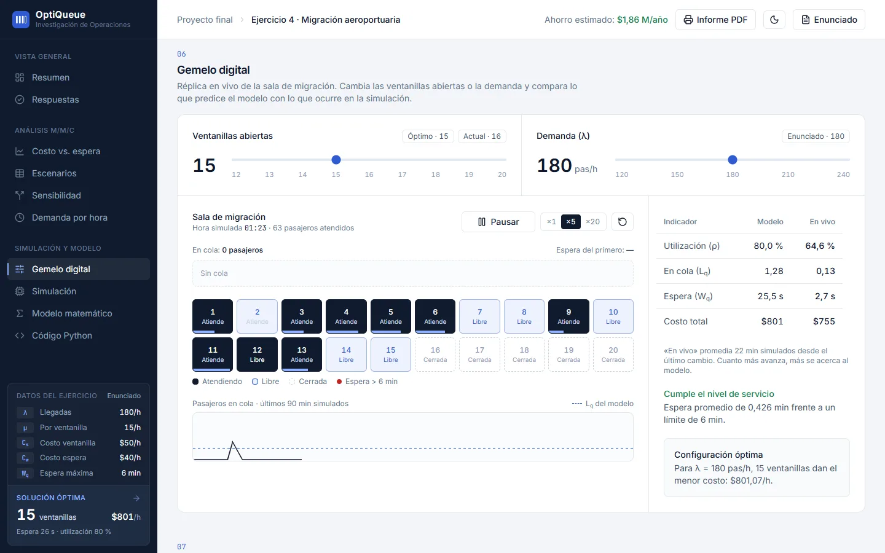
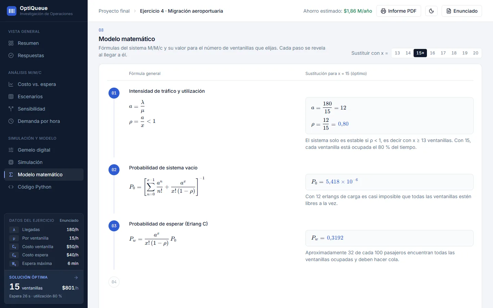
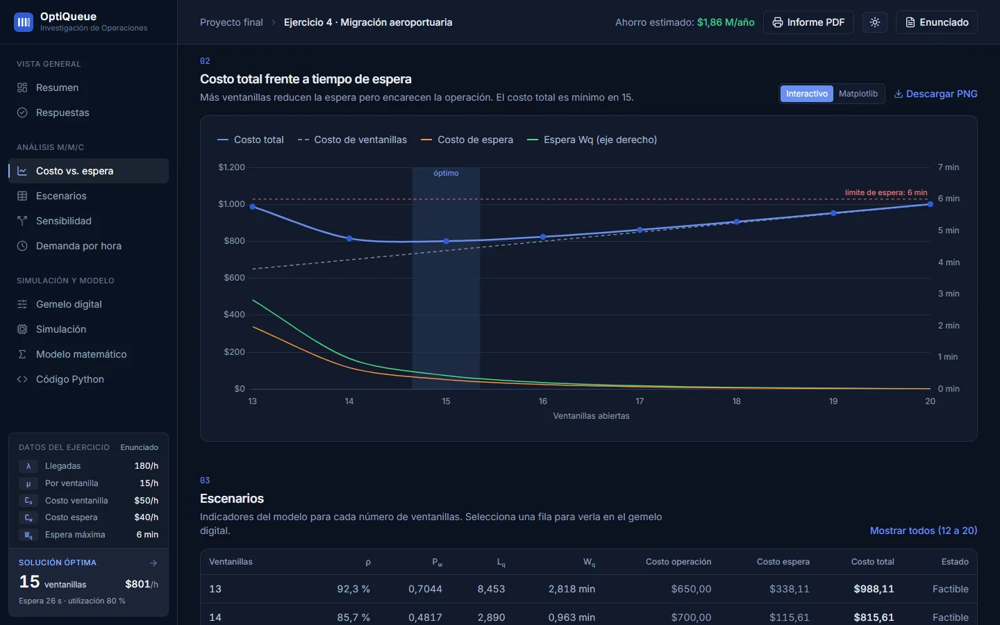
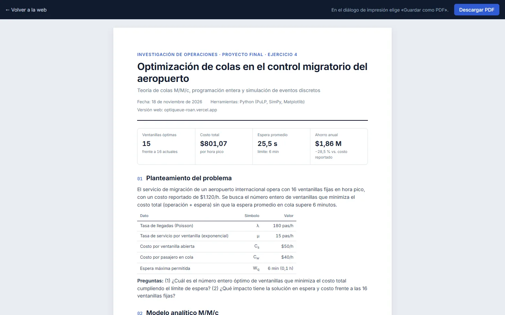

# OptiQueue · Software de optimización de colas

[](https://github.com/Urafael-Dev/optiqueue/actions/workflows/ci.yml)
[](https://colab.research.google.com/github/Urafael-Dev/optiqueue/blob/main/python/OptiQueue.ipynb)

**Web:** https://optiqueue-roan.vercel.app · **Informe técnico:** [Word](https://optiqueue-roan.vercel.app/descargas/OptiQueue_Informe_Final.docx) · [PDF](https://optiqueue-roan.vercel.app/descargas/OptiQueue_Informe_Final.pdf) · **Resumen imprimible:** https://optiqueue-roan.vercel.app/informe.html

OptiQueue dimensiona puntos de atención: cuántos servidores abrir para minimizar el costo sin superar un tiempo de espera
objetivo. Incluye un panel con el caso de demostración (control migratorio de un aeropuerto: ¿cuántas ventanillas abrir en
hora pico sin que la espera promedio supere 6 minutos?), un gemelo digital 3D, un resolvedor para cualquier sistema de colas y
un asistente con IA.



## Resultado

| | |
|---|---|
| Ventanillas óptimas | **15** (frente a 16 actuales) |
| Costo total | **$801,07/h** ($750 operación + $51,07 espera) |
| Espera promedio | **25,5 s** (límite: 6 min) · utilización 80 % |
| Ahorro frente a 16 ventanillas | **$318,93/h (−28,5 %)** ≈ **$1,86 M/año** |

Datos: λ = 180 pas/h, μ = 15 pas/h por ventanilla, C<sub>s</sub> = $50/h, C<sub>w</sub> = $40/h, W<sub>q</sub> ≤ 6 min.

## Qué incluye

- **Modelo M/M/c (Erlang C):** fórmulas paso a paso con KaTeX, sustituidas para cualquier número de ventanillas.
- **Programación entera:** linealización con cortes secantes, resuelta con PuLP + CBC.
- **Análisis de sensibilidad:** rango de optimalidad de μ, C<sub>w</sub>, C<sub>s</sub>, W<sub>q</sub> y λ. Por ejemplo,
  x\* = 15 se mantiene mientras C<sub>w</sub> esté entre $30,99 y $75,41/h, pero basta con que μ baje de 14,21 pas/h para que convenga abrir 16.
- **Demanda por hora del día:** perfil de 24 h resuelto hora a hora (método SIPP). Ahorra unos $5.469/día (−30 %) frente a 15 ventanillas fijas.
- **Gemelo digital:** sala de migración animada en tiempo real que compara el modelo con lo que ocurre en vivo.
- **Resolvedor universal de colas** (`resolver.html`): resuelve cualquier ejercicio de M/M/1, M/M/c, M/M/1/K, M/M/c/K (Erlang B), población finita M/M/c//N, M/G/1, M/D/1, M/Eₖ/1 y M/M/∞ con desarrollo paso a paso, distribución Pₙ, probabilidades de espera, costos y número óptimo de servidores. Incluye ejemplos clásicos y se puede compartir por URL.
- **Asistente con IA (Claude):** chat que explica el modelo, lee y resuelve ejercicios de colas redactados en texto (los carga en el resolvedor), modifica la app en modo exploración, compara escenarios, calcula otros escenarios, ejecuta la simulación, analiza la sensibilidad y lleva al usuario a la sección o configuración del gemelo que necesita. Usa los mismos cálculos de la app.
- **Simulación de eventos discretos:** réplicas con semilla e intervalos de confianza.
- **Informe final** descargable en Word y PDF (menú «Informe» de la barra superior), **resumen imprimible** generado con los cálculos y **notebook de Jupyter** con todo el desarrollo y sus salidas.
- Modo oscuro, diseño adaptable a móvil y accesible con teclado.

| Sensibilidad | Demanda por hora |
|---|---|
|  |  |
| **Gemelo digital** | **Modelo matemático** |
|  |  |
| **Modo oscuro** | **Informe PDF** |
|  |  |

## Web (Vite)

```bash
npm install
npm run dev       # servidor de desarrollo (http://localhost:5173)
npm test          # pruebas del modelo, sensibilidad y fórmulas (Vitest)
npm run build     # build de producción en dist/
npm run preview   # sirve dist/
```

Para cambiar el escenario (λ, μ, costos, límite de espera) basta con editar `src/config.js`: indicadores, tablas, gráficos,
textos, informe y simulación se recalculan solos.

## Asistente con IA

El botón **Asistente IA** (abajo a la derecha) abre un chat con Claude. El navegador ejecuta las herramientas del asistente
(cálculo M/M/c, optimización, sensibilidad, simulación, navegación y control del gemelo) con el código de `src/lib/`, y la
función `api/asistente.js` solo hace de intermediaria: guarda la clave y transmite la respuesta en vivo.

Necesita una clave de la API de Anthropic en la variable de entorno `ANTHROPIC_API_KEY`:

- **Vercel:** *Project → Settings → Environment Variables*, agregar `ANTHROPIC_API_KEY` y volver a desplegar.
- **Local:** crear `.env.local` con `ANTHROPIC_API_KEY=sk-ant-...` (no se sube al repositorio); `npm run dev` y
  `npm run preview` sirven `/api/asistente` con el mismo código.

### Encender o apagar la IA

El asistente se controla desde el servidor con la variable `ASISTENTE_IA` (`on` por defecto):

- **Local:** `npm run ia:off` / `npm run ia:on` (escribe `ASISTENTE_IA` en `.env.local`).
- **Vercel:** *Settings → Environment Variables* → `ASISTENTE_IA = off` y volver a desplegar.

Apagado, el servidor rechaza cualquier llamada a `/api/asistente` (aunque alguien la haga a mano) y las páginas ocultan el
asistente por completo. Sin clave de API ocurre lo mismo: la app funciona igual, sin IA. El servidor limita el tamaño de
cada conversación y la cantidad de preguntas por IP. El modelo y su configuración están en `server/asistente.js`.

## Python

```bash
cd python
pip install -r requirements.txt
python modelo.py        # tabla de escenarios y óptimo con PuLP
python simulacion.py    # validación con SimPy
python grafico.py       # genera grafico_analitico.png
```

`python/OptiQueue.ipynb` reúne todo el desarrollo (modelo, PuLP, gráfico, SimPy, sensibilidad y demanda por hora) con las
salidas ya ejecutadas. Se puede abrir directamente en Google Colab con el botón de arriba.

> PuLP se fija en `<4`: la versión 4 cambió la API y ya no incluye el solver CBC.

## Estructura

```
index.html                 Página principal (barra lateral, secciones y diálogos)
informe.html               Informe imprimible (A4 / PDF)
src/config.js              Parámetros del enunciado (única fuente de verdad)
src/lib/queue.js           Modelo M/M/c, optimización y ahorro
src/lib/sensitivity.js     Rangos de optimalidad y variaciones ±20 %
src/lib/hourly.js          Perfil de demanda y plan hora a hora
src/lib/simulation.js      Simulación de eventos discretos con réplicas
src/lib/liveSim.js         Motor en tiempo real del gemelo digital
src/lib/formulas.js        Fórmulas LaTeX y su renderizado con KaTeX
src/sections/*.js          Secciones de la interfaz
python/                    Código Python, notebook, salidas reales y resultados_mmc.csv
public/descargas/          Informe final del proyecto (Word y PDF)
tests/                     Pruebas (Vitest)
.github/workflows/ci.yml   Tests, build y ejecución del código Python en cada cambio
legacy/                    HTML original, conservado como referencia
```

Despliegue: Vercel (`vercel deploy --prod`).

Vídeo de portada: [«Looking at the clouds from a plane window»](https://mixkit.co/free-stock-video/looking-at-the-clouds-from-a-plane-window-2684/), Mixkit (Mixkit Stock Video Free License).
